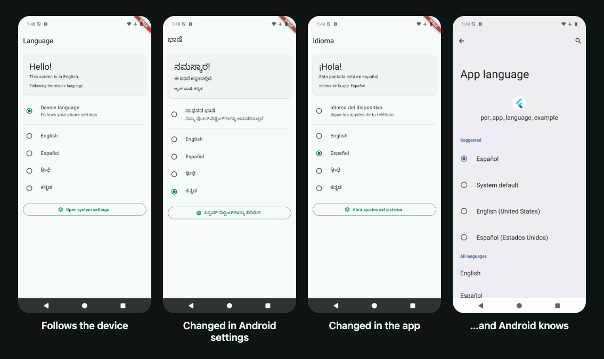

# per_app_language

[](https://pub.dev/packages/per_app_language)
[](https://github.com/ManukumarSB/per_app_language/actions/workflows/ci.yml)

Let people pick your app's language in the phone's own settings — Android
13+ and iOS both have a per-app language screen — and keep Flutter in sync
with it, in both directions.

Flutter doesn't wire this up for you ([flutter#109842](https://github.com/flutter/flutter/issues/109842)),
and the native side is fiddly: Android wants a `locales_config.xml` and a
manifest attribute, iOS wants `CFBundleLocalizations` in Info.plist, or the
setting simply never shows up. This plugin does the runtime part and comes
with a command that writes that config from your `.arb` files.



## Install

```sh
flutter pub add per_app_language
```

## Setup

**1. Declare your languages to the OS.** From your app's root:

```sh
dart run per_app_language:setup
```

It reads the locales from your `.arb` files (using `arb-dir` from `l10n.yaml`)
and writes:

| File | Change |
|---|---|
| `android/app/src/main/res/xml/locales_config.xml` | created |
| `android/app/src/main/AndroidManifest.xml` | adds `android:localeConfig` |
| `ios/Runner/Info.plist` | sets `CFBundleLocalizations` |

Run it again whenever you add a language; it only touches what changed.
Not using `.arb` files? Pass them in: `--locales en,es,pt-BR`. In CI,
`--check` exits with code 1 if the config is out of date.

**2. Hook it into your app.**

```dart
import 'package:per_app_language/per_app_language.dart';

Future<void> main() async {
  WidgetsFlutterBinding.ensureInitialized();
  await AppLanguage.init(); // read the saved choice before the first frame
  runApp(const MyApp());
}

class MyApp extends StatelessWidget {
  const MyApp({super.key});

  @override
  Widget build(BuildContext context) {
    return AppLanguageBuilder(
      builder: (context, locale) => MaterialApp(
        locale: locale,
        supportedLocales: AppLocalizations.supportedLocales,
        localizationsDelegates: AppLocalizations.localizationsDelegates,
        home: const HomePage(),
      ),
    );
  }
}
```

**3. Change it from your settings screen.**

```dart
AppLanguage.set(const Locale('es'));  // switch to Spanish
AppLanguage.set(null);                // back to the device language

AppLanguage.selected;                 // Locale('es'), or null when following the device

if (await AppLanguage.hasSystemSettings()) {
  AppLanguage.openSystemSettings();   // the OS's own per-app language screen
}
```

The app switches straight away, and the choice shows up in system settings.
If the user changes it there instead, the app picks it up.

## How it behaves

| | Android 13+ | Android 12 and older | iOS |
|---|---|---|---|
| Choice shown in system settings | yes | — (no such setting) | yes |
| Changed in system settings | app updates while running | — | iOS relaunches the app |
| Stored by | the OS (`LocaleManager`) | this plugin | the OS (`AppleLanguages`) |
| `openSystemSettings()` | per-app language screen | returns false | the app's Settings page |

On web and desktop the choice is kept for the session only.

## Things to know

- **iOS native strings switch on the next launch.** Flutter switches
  immediately, but things iOS renders itself — permission prompts, strings
  from `InfoPlist.strings` — follow the language the app was launched in.
- **Android needs nothing else.** No AppCompat dependency, no activity
  restart: Flutter's activity already handles locale changes itself.
- **Includes a privacy manifest.** The iOS side stores the choice in
  `UserDefaults`, which Apple counts as a required-reason API, so the plugin
  ships its own `PrivacyInfo.xcprivacy` (reason `CA92.1`).
- **Swift Package Manager and CocoaPods** are both supported.

## Contributing

Issues and PRs are welcome. Please run `flutter analyze` and `flutter test`
before opening a PR. The example has integration tests that run against the
real native code:

```sh
cd example && flutter test integration_test -d <device>
```
